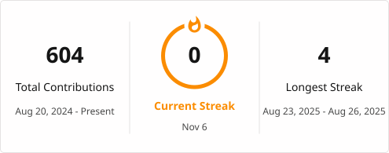

<!-- Os componentes animados ficam em assets/svg/ (cada .svg traz suas próprias animações no <style>). -->

 

<!-- 01 — PERFIL -->

<!-- 02 — STATUS DA MISSÃO -->

<!-- 03 — LABORATÓRIO -->

<!-- 04 — ARSENAL -->

<!-- 05 — MAPA DAS MISSÕES -->

<!-- 06 — INTERCEPTAÇÃO -->

<b>🔍 Ver o veredito da análise</b>

 

**RISCO: ALTO. É golpe.** 🚨

- **Domínio falso:** `correios-rastreio-br.com` não é o site oficial dos Correios (`correios.com.br`).
- **Urgência artificial:** “em até 24h” serve para você agir sem pensar.
- **Valor baixo de propósito:** R$ 12,90 parece inofensivo, mas o objetivo é capturar os dados do seu cartão.
- **Canal suspeito:** SMS de número desconhecido com link de pagamento.

> Na dúvida, não clique: acesse o site oficial digitando o endereço você mesma(o).

<!-- 07 — RELATÓRIO DE ATIVIDADE -->

<!-- Gerado diariamente por .github/workflows/metrics.yml (estatísticas, linguagens e conquistas) -->

  

<!-- Gerado diariamente por .github/workflows/streak-stats.yml (cores definidas lá) -->

  

<!-- 🐍 Gerada por .github/workflows/snake.yml (rode uma vez em Actions → "Gerar cobrinha") -->

  

<!-- 08 — CANAL SEGURO -->

  Me chama pra falar de IA, golpes digitais e ameaças emergentes, ou só pra trocar ideia sobre a faculdade.

<!-- Contatos: TROQUE SEU-USUARIO e SEU-EMAIL pelos seus dados -->

  
  

